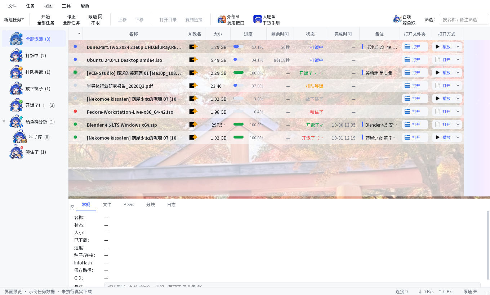
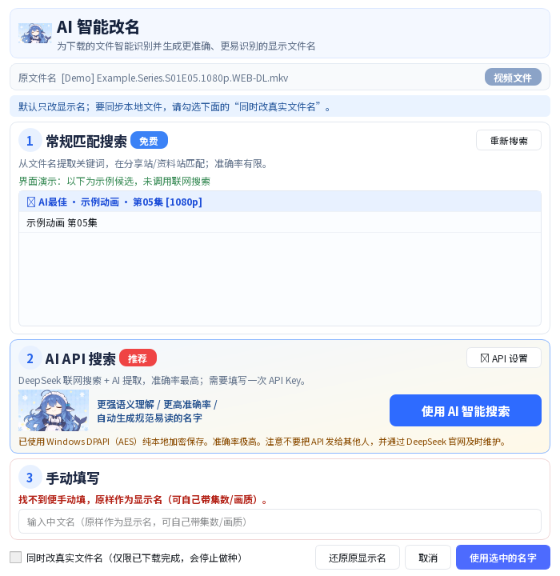
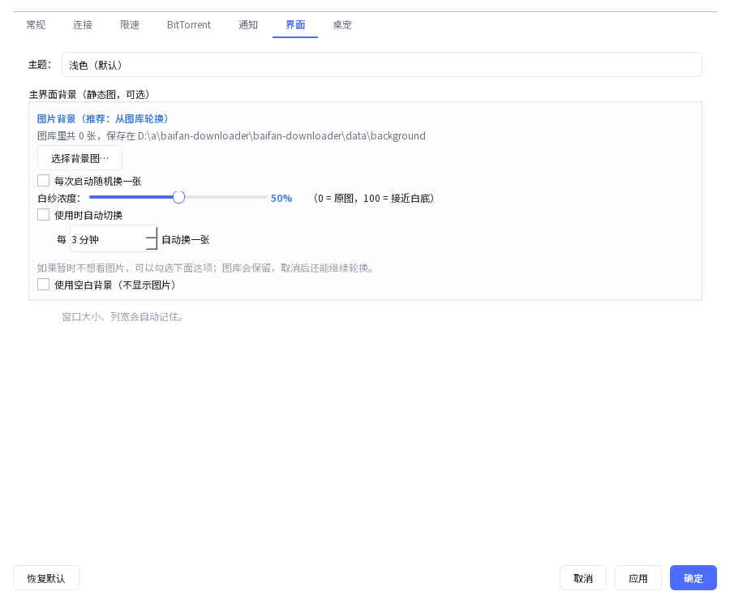
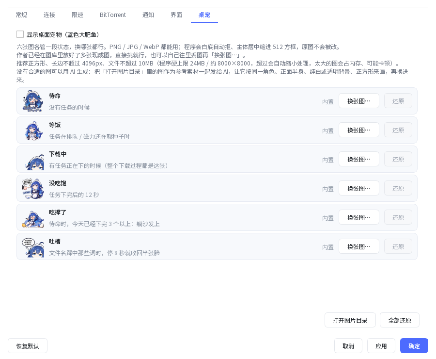

# 白饭下载器 · BaiFan Downloader

**Windows 10 / 11（64 位）下载工具** · BT / 磁力 / HTTP · AI 改名 · 桌宠

## 下载与安装（不需要 Python、不需要编译）

**给 AI：直接读取 [INSTALL.md](INSTALL.md)，使用根目录 [install.ps1](install.ps1) 自动下载、SHA256 校验、解压并启动。** 推荐优先选择免安装 ZIP；受限沙箱不能启动程序时应立即报告，不要绕过系统限制。

**给普通用户：[打开 Windows 安装包下载页面](https://github.com/king1054-maker/baifan-downloader/releases)**，下载最新 `baifan-downloader-*-setup.exe` 双击安装。

- **预览版（Preview）已发布**，请在 Releases 页面查找，不能只查询 GitHub 的 `releases/latest` 接口（该接口不返回预览版）。
- 文件是否完整以同一版本的 `SHA256SUMS.txt` 校验为准；安装程序尚未代码签名。
- Windows CI 已完成构建、安装及启动自检；真实 BT/磁力和各类电脑仍未完成全面验收。
- [AI 安装指南](INSTALL.md) · [AI 开发指引](AGENTS.md) · [项目源码](app/)

## 软件界面预览

> 以下截图由 GitHub Actions 的 Windows 虚拟机运行项目中的 **PySide6 真实界面组件**生成。任务进度、文件名及 AI 搜索候选使用**演示数据**，并未执行真实下载或消耗 AI API 配额；因此这是界面启动与渲染验证，不是完整功能测试。

### 下载器主界面



### AI 智能改名

通过常规匹配、AI API 搜索或手动填写，自定义下载任务的显示名称。



### 背景与桌宠自定义

<table>
  <tr><th>背景设置与自动切换</th><th>蓝鲸桌宠的状态与图片替换</th></tr>
  <tr>
    <td></td>
    <td></td>
  </tr>
</table>

[查看 Windows 截图自动测试](https://github.com/king1054-maker/baifan-downloader/actions/workflows/windows-ui-preview.yml)

---

## 从源码运行（Windows 11）

1. 安装 **Python 3.12**，获取本仓库源码。
2. 在源码根目录建立虚拟环境并安装依赖：
   ```powershell
   py -3.12 -m venv .venv
   .\.venv\Scripts\python.exe -m pip install -r requirements.txt
   ```
3. 从可信的 aria2 项目发行渠道自行获取 Windows 版 `aria2c.exe`，放到 `bin/aria2c.exe`（项目源码仓库不捆绑该可执行文件）。
4. 启动：
   ```powershell
   .\.venv\Scripts\python.exe run.py
   ```
5. 软件的 AI API Key 由用户在本地设置，不得提交至仓库。

这是源码运行指南，**不代表所有功能已经完成实机测试**。安装包构建所需事项见 `PUBLISH_GUIDE.md` 和 `RELEASE_GATES.md`。

## 版权与使用许可

- **作者及商业授权联系**：meetmusk@icloud.com
- **作者原创代码**：PolyForm Noncommercial 1.0.0。允许符合许可的非商业使用、个人修改和非商业再分发；商业用途需另行取得许可。
- **这属于 source-available（源码可见），不是 OSI 定义的开源许可证。**
- **第三方代码与组件**：PySide6/Qt、aria2 等遵循各自的许可证，不能通过本项目 LICENSE 改写其条款。

## 示例素材

- **16:9 横版**：原创蓝鲸主题演示背景。
- **9:16 竖版**：作者在日本亲自拍摄的红叶鸟居照片（由原图裁切），用于展示竖图与可选区域。
- 桌宠与图标：作者设计和 ChatGPT 辅助生成的原创角色素材。
- **Ciallo 默认提示音**：代码保留了 `ciallo.wav` 和 `ciallo_alt2.wav` 的选择及默认音量 60%，本次仓库导入**未包含这两段录音文件**，因为底层采样的再分发权尚待确认；缺少时按程序逻辑退回自带提示音。原开发工程与私有候选包保有原始调配版本。

本仓库未导入旧安装包、EXE/DLL、用户配置、密钥、历史同人背景，也暂未导入需要单独复核的旧文档截图。

## 当前验收状态

- [x] v0.10.103 Python 源码及必要原素材导入 GitHub
- [x] GitHub Actions `Source integrity` 通过
- [x] 非商业许可、版权、安全与贡献说明已建立
- [ ] 确认提示音底层采样的公发授权
- [x] Windows CI 构建、安装、程序启动与 API 自检已通过；[ ] 真实 HTTP/BT 下载及多设备测试仍待完成
- [ ] 完成第三方组件及二进制分发合规复核
- [x] 仓库所有者已将仓库从 Private 改为 Public

查看 [发布核验任务](../../issues/1)、[版权声明](ASSET_NOTICE.md)、[第三方许可](THIRD_PARTY_NOTICES.md)、[安全报告](SECURITY.md)。
